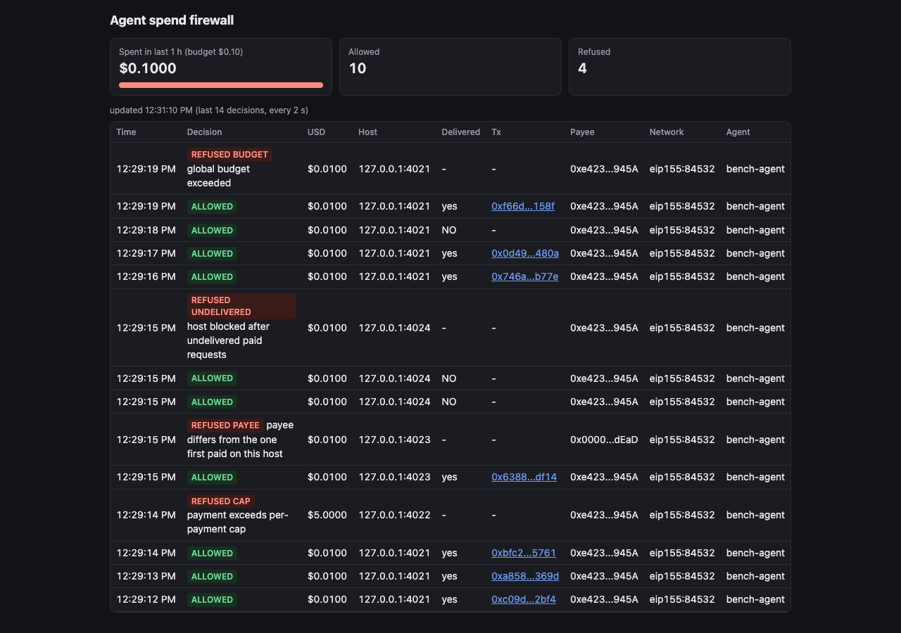

# agent-spend-firewall

A spend firewall for AI agents that pay over [x402](https://github.com/x402-foundation/x402). The signing key and the spending rules live in a separate process the agent cannot reach.

**Status: MVP on testnets (Base Sepolia, Solana devnet). Pre-release, no audit. Do not use with real keys or real money.**

## The problem

The official x402 client caps a single payment at $1 by default. It does not limit what an agent spends over time, how long a signed authorization stays valid, or who gets paid. In our measurements the default client signed 100 authorizations of $0.99 for a page that advertised $0.01 per call, and signed an authorization valid for ten years. Any limit that lives inside the agent can be removed by a compromised agent.

## How it works

```
 agent (token only, no key)
    |  MCP tool fetch_paid_resource(url)   or   POST /fetch
    v
 +-------------------- firewall process (holds the keys) --------------------+
 |  fetch URL -> 402  ->  reader  ->  policy  ->  state  ->  guarded signer  |
 |                        (exact      (caps,      (spend     (signs only what |
 |                         bytes)      rules)      history)   the gate allowed)|
 +----------------------------------------------------------------------------+
    |  signed payment header, retry
    v
 seller / facilitator
```

The agent sends a URL and a bearer token. The firewall fetches it, and on a 402 reads the exact bytes it is about to sign (EIP-712 typed data on EVM, the transaction message on Solana), checks them against the owner's policy and its own spend history, and only then signs. The key never leaves the firewall. Every decision is written to an append-only log (no keys, tokens, URL paths or bodies).

## What is enforced

A payment is refused, and nothing is signed, when:

- it is above the per-payment cap, or below the minimum amount;
- the agent, the host, or everyone together would exceed the budget for the rolling window;
- the payee is not on the allowlist, or differs from the payee first paid on that host (pinning);
- the authorization would stay valid longer than the validity limit;
- the same authorization is presented twice (replay), or too many signatures were made in the window;
- the host already took money without delivering (blocked after N undelivered paid requests);
- the URL resolves to a loopback, private, link-local or other internal address (SSRF guard, checked on the connection itself) or redirects;
- the bytes do not match the payment requirements, carry an unknown instruction, a durable nonce, or are not from the guarded wallet;
- it is not x402 v2 `exact` on Base Sepolia or Solana devnet, or the asset is not on the list.

## Quick start

Needs Node 23.6 or newer.

```
npm ci --ignore-scripts
npm run demo
```

The first run creates a testnet key and prints the payer address. Fund it with free test USDC (Base Sepolia) at https://faucet.circle.com, then run `npm run demo` again. The demo starts a local seller and the firewall, runs a demo agent through nine scenarios plus a budget burst, and prints a summary with explorer links. It spends at most $0.10 of test USDC. `npm run demo -- --keep` leaves the seller and firewall running; the dashboard is at http://127.0.0.1:8402/. Manual setup and Solana: `bench/README.md`.

## Results

Live run on Base Sepolia, 2026-11-18 (details and transaction links: [bench/RESULTS-2026-11-18.md](bench/RESULTS-2026-11-18.md)):

| Scenario | Outcome |
|---|---|
| `/good` ($0.01) | allowed, delivered, settled on chain |
| `/pricey` ($5.00) | REFUSED CAP, nothing signed |
| payee switch on the same host | REFUSED PAYEE |
| seller takes payment, returns 500 | two allowed, third REFUSED UNDELIVERED |
| burst on `/good` | allowed until the $0.10 budget, then REFUSED BUDGET |

A real Claude agent (Claude Code, Sonnet) was given only the `fetch_paid_resource` MCP tool and bench sources including the $5 report and a failing seller. Every refusal held, six payments settled, and the agent did not try to get around any refusal.



## Use it from an AI agent (MCP)

The agent gets one MCP tool, `fetch_paid_resource(url)`, and only a bearer token, never a key. Every payment is decided by the firewall.

```json
{
  "mcpServers": {
    "spend-firewall": {
      "command": "node",
      "args": ["/path/to/agent-spend-firewall/src/mcp.ts"],
      "env": {
        "ASF_FIREWALL_URL": "http://127.0.0.1:8402",
        "ASF_AGENT_TOKEN_FILE": "/home/you/.agent-spend-firewall/agent.token"
      }
    }
  }
}
```

Claude Code: `claude mcp add spend-firewall -e ASF_AGENT_TOKEN_FILE=$HOME/.agent-spend-firewall/agent.token -- node /path/to/agent-spend-firewall/src/mcp.ts`. Spec: `contracts/M7-mcp.md`.

## Limits and open issues

- Solana: reading, policy and signing work, but live settlement is pending our own devnet facilitator funding (#11, #7); the public facilitator fails on devnet RPC limits.
- A signed but unsettled authorization still counts against the budget until it expires, because the seller could still submit it.
- Testnet assets only, stablecoins only (USD), `exact` scheme only. No mainnet, no other schemes.
- Pre-release, not audited. Keys are plain files with mode 0600 under `~/.agent-spend-firewall`.
- The firewall protects the payment path; it does not judge whether the content bought is useful.

## How it is built

Built by a set of AI agents with separated roles: builder, tester who never sees the code, attacker, spec warden and critic, with a script gate that recomputes every number. See [ARCHITECTURE.md](ARCHITECTURE.md). Module specs are frozen in `contracts/` (M1 policy, M2/M3 readers, M4 state, M5 keys, M6 firewall, M7 MCP). Choices and their reasons: [DECISIONS.md](DECISIONS.md). CI runs typecheck and tests on every push and pull request; a pre-commit hook (`scripts/secret-scan.mjs`) refuses keys and secrets. See [CONTRIBUTING.md](CONTRIBUTING.md).

## License

Apache-2.0.
