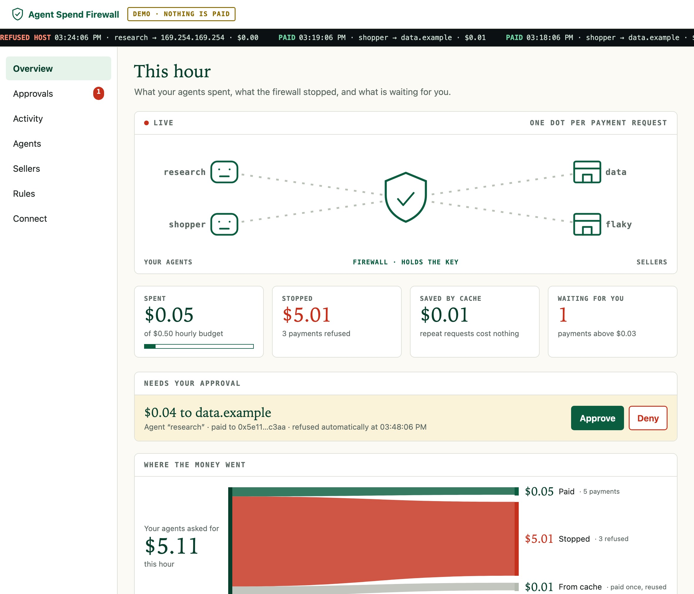

# agent-spend-firewall

A spend firewall for AI agents that pay over [x402](https://github.com/x402-foundation/x402). The signing key and the spending rules live in a separate process the agent cannot reach.

**Status: MVP on testnets (Base Sepolia, Solana devnet). Pre-release, no audit. Do not use with real keys or real money.**



The owner console, here with the demo data from `docs/console/`. More screens: [approvals](docs/shots/approvals.jpg) · [agents](docs/shots/agents.jpg) · [rules](docs/shots/rules.jpg) · [a watch](docs/shots/watch.jpg) · [report](docs/shots/report.jpg).

## The problem

The official x402 client caps a single payment at $1 by default. It does not limit what an agent spends over time, how long a signed authorization stays valid, or who gets paid. In our measurements the default client signed 100 authorizations of $0.99 for a page that advertised $0.01 per call, and signed an authorization valid for ten years. Any limit that lives inside the agent can be removed by a compromised agent.

## How it works

```
 agent (token only, no key)
    |  MCP tool fetch_paid_resource(url)   or   POST /fetch
    v
 +-------------------- firewall process (holds the keys) --------------------+
 |  fetch URL -> 402  ->  reader  ->  policy  ->  state  ->  guarded signer  |
 |                        (exact      (caps,      (spend     (signs only what |
 |                         bytes)      rules)      history)   the gate allowed)|
 +----------------------------------------------------------------------------+
    |  signed payment header, retry
    v
 seller / facilitator
```

The agent sends a URL and a bearer token. The firewall fetches it, and on a 402 reads the exact bytes it is about to sign (EIP-712 typed data on EVM, the transaction message on Solana), checks them against the owner's policy and its own spend history, and only then signs. The key never leaves the firewall. Every decision is written to an append-only log (no keys, tokens, URL paths or bodies).

## What is enforced

A payment is refused, and nothing is signed, when:

- it is above the per-payment cap, or below the minimum amount;
- the agent, the host, or everyone together would exceed the budget for the rolling window;
- the payee is not on the allowlist, or differs from the payee first paid on that host (pinning);
- the authorization would stay valid longer than the validity limit;
- the same authorization is presented twice (replay), or too many signatures were made in the window;
- the host already took money without delivering (blocked after N undelivered paid requests);
- the URL resolves to a loopback, private, link-local or other internal address (SSRF guard, checked on the connection itself) or redirects;
- the bytes do not match the payment requirements, carry an unknown instruction, a durable nonce, or are not from the guarded wallet;
- it is not x402 v2 `exact` on Base Sepolia or Solana devnet, or the asset is not on the list.

## Quick start

Needs Node 23.6 or newer.

```
git clone https://github.com/dyzdy00-prog/agent-spend-firewall
cd agent-spend-firewall
npm ci --ignore-scripts
npm start
```

`npm start` is the whole setup. On the first run it creates a private settings folder (`~/.agent-spend-firewall`: config, a testnet wallet, one agent token and one admin token, all mode 0600), starts the firewall on `127.0.0.1:8402` and opens the owner console in your browser, already signed in. The terminal prints the wallet address to fund with free test USDC and the exact `claude mcp add` line for your paths. Later runs reuse the same folder and change nothing in it.

`npm start -- --practice` also starts a local practice seller and, the first time, runs a demo agent against it, so the console shows real decisions straight away: a price above the cap, a seller that swaps its wallet, a seller that takes the payment and returns nothing. While it runs, the console has a Practice panel: buttons that ask as one of your agents (an ordinary purchase, the same one again, a $0.04 dataset that waits for your approval, a runaway loop, a seller that asks twice as much the second time, a metadata address), so you can try every rule by hand. Practice purchases are signed by your firewall for real and accepted by a practice facilitator on your machine, so no money moves and no test USDC is needed; the console says so in its header. `npm start -- --practice --onchain` settles them on Base Sepolia through the public facilitator instead (the wallet then needs test USDC, and that facilitator fails now and then). `npm start -- --no-open` skips the browser.

### The scripted demo

`npm run demo` runs the same scenarios in a throwaway folder and prints a summary. The first run creates a testnet key and prints the payer address. Fund it with free test USDC (Base Sepolia) at https://faucet.circle.com, then run `npm run demo` again. The demo starts a local seller and the firewall, runs a demo agent through nine scenarios plus a budget burst, and prints a summary with explorer links. It spends at most $0.10 of test USDC. `npm run demo -- --keep` leaves the seller and firewall running; the dashboard is at http://127.0.0.1:8402/. Manual setup and Solana: `bench/README.md`.

## What the console does

Everything below is in the owner console at `/app`. The demo console in `docs/console/` shows the same screens with pretend data.

### Limits

Daily limits: the budget above is a rolling window (an hour by default) and refills as time moves on, so an agent that works around the clock can spend one budget after another. A **daily limit** counts everything paid in the last 24 hours and does not refill: set one for all agents together in Rules (`policy.daily_budget_usd`) and one per agent on the agent's page (`policy.agents.<id>.daily_budget_usd`). A payment that would pass it is refused with `DAILY_BUDGET`. An agent's hourly budget and daily limit can be changed on its page at any time; its token stays the same.

Weekly and monthly limits: **Most per week and per month** in Rules (`policy.weekly_budget_usd`, `policy.monthly_budget_usd`) count all agents together over the last 7 and the last 30 days; a payment past either is refused with `LONG_BUDGET`. While one is set, spending is remembered that long. One agent can have its own week and month too (`policy.agents.<id>.weekly_budget_usd`, `monthly_budget_usd`), on its page under Its limits.

Seller limits: **Most to one seller** in Rules caps what any single seller can be paid, all agents together, per hour (`policy.host_budget_usd`) and in any 24 hours (`policy.host_daily_budget_usd`). Without it one address can take the whole budget, hour after hour. A payment past either is refused with `HOST_BUDGET`.

The same limits as another agent: on an agent’s page, “Fill in its limits” puts another agent’s hourly, daily, weekly and monthly limits into the fields. Nothing changes until you press Save; the list of sellers is not copied.

One seller's own rules: on a seller's page, **Your rules for this seller** sets a daily limit for that seller alone (it replaces the general per-seller daily limit for it, higher or lower) or blocks it, so no agent can pay it until you unblock it (`PUT /admin/sellers/<host>` with `daily_budget_usd` and `blocked`; `policy.sellers` in the config).

What was changed: the firewall keeps the last 500 changes made in the console (a rule, a pause, an agent created, revoked or given new limits) with the old and the new value, in a 0600 file next to its state (`GET /admin/changes`). Rules lists the last 15; the Report lists the ones made in its period, and they are in its CSV.

Sellers one agent may pay: on the agent's page, **Sellers it may pay** lists the sellers that agent is for (`policy.agents.<id>.hosts`, `PUT /admin/agents/<id>` with `hosts`). A payment to anyone else is refused with `HOST` before signing. Empty means any seller the other rules allow.

Protection between payments (Rules in the console, both off until you turn them on): **first payments to a new seller** are limited to a small amount until that seller delivers once, after which your ordinary limit applies (`policy.new_seller_cap_usd`, refusal `NEW_SELLER`); **same address, higher price** refuses a quote that is more than N times what that address cost the last time it delivered (`max_price_jump`, refusal `PRICE_JUMP`). And always on: a seller that takes the payment and answers with an empty body is counted as not having delivered, like one that answers with an error.

The agent's own ceiling: a request can say the most the agent agrees to pay for it (`max_usd` in `POST /fetch`, and in the MCP tool `fetch_paid_resource`). A seller that lists one price and asks for more at payment time is refused with `ABOVE_MAX` before anything is signed, even when the higher price is still inside the owner's limits. The ready-made agents send every listing's price as their ceiling. The same address already in the cache is still answered for free.

Paying once: two requests for the same paid address at the same moment are paid once; the second waits and gets the answer from the cache. With **Agents share what was already bought** on (`share_cache`), that also holds across your agents: what one agent paid for answers the same address for the others while it is cached, and the activity says which agent paid.

Stop switch: **Pause all payments** in the console's top bar stops every agent at once. Nothing is signed until you press **Resume payments**; payments that were waiting for your approval are refused, scheduled runs are skipped, and the pause survives a restart. Free pages and answers already in the cache still work.

Pause one agent: **Pause** next to an agent (Agents, or the agent's own page) stops signing for that agent only; the others keep working. Its payments that wait for your approval are refused, its scheduled runs are skipped, and free pages and cached answers still reach it. The refusal is `PAUSED` with the reason `this agent is paused by the owner`. Kept in the config (`pausedAgents`), so it survives a restart. **Resume** lifts it.

Pause by itself: **Pause an agent that keeps being refused** in Rules (`auto_pause_after`, off by default). An agent refused that many times in a row, with no payment in between and no gap longer than ten minutes, is paused by the firewall: the same pause as the button, kept in the config, and one alert to the owner. Refusals the owner made (a denied approval, a pause) are not counted. The count is kept in memory, so a restart starts it again.

What an agent can see: `spend_report` starts with the largest single payment the limits allow right now (per-payment limit, what is left this hour and in the last 24 hours, whether payments are paused), so an agent can check before it asks instead of learning its limits by being refused.

Waiting for your answer: a payment above the ask-me amount waits for your click, two minutes unless you choose otherwise. On the Rules page, under “Ask me before larger payments”, pick one minute to one hour (`approval_timeout_s`, 10–3600 seconds, through `PUT /admin/rules`). No answer in that time means no payment. A payment that is already waiting keeps the wait it started with.

### Ready-made agents

Creating an agent: under Agents in the console, pick what the agent does (the ready-made Researcher, or your own agent for any MCP client), give it a name and an hourly budget, and you get its token once.

Researcher (`agents/researcher.ts`): a ready-made buying agent with no key and no model. Given a topic it reads a seller's index of paid notes, buys them one by one through the firewall and returns the notes with a receipt: paid, bought, stopped by the firewall, paid and not delivered, saved by the cache. With `npm start -- --practice` the console runs it at the press of a button against the practice seller (one note is priced over the cap, one seller takes the payment and delivers nothing, so the receipt shows both). By hand: `node agents/researcher.ts "your topic"` with `ASF_AGENT_TOKEN_FILE`, `ASF_RESEARCH_INDEX` and `ASF_RESEARCH_HOSTS`. The practice notes are filler; what the run shows is the buying and the receipt.

Shopper (`agents/shopper.ts`): the second ready-made agent, also with no key and no model. Given one thing to buy and several sellers' listed prices, it tries the cheapest listing first, moves to the next one when the firewall stops the payment or the seller does not deliver, and stops at the first delivery. The receipt says what it paid, what the dearest listing asked, and what was lost on the way. With `--practice` four practice sellers list the same item: the cheapest asks $5.00 at payment time (refused: more than it listed), the next takes the payment and delivers nothing, the third delivers, the dearest is never asked. By hand: `node agents/shopper.ts "what to buy"` with `ASF_AGENT_TOKEN_FILE`, `ASF_SHOP_QUOTES` and `ASF_SHOP_HOSTS`. Both agents can also run against live testnet sellers, below.

Watcher (`agents/watcher.ts`): the third ready-made agent, for things that change. Each run buys one paid address again, fresh (never from the cache), and compares the answer with the one from the last run: FIRST LOOK, SAME or CHANGED, with a receipt. Put it on a schedule; with alerts on, the owner gets a message only when the answer changed. With `--practice` the practice seller sells a reading that changes every minute. What each watch saw last is kept in `~/.agent-spend-firewall/watch.json` (a fingerprint, not the text). By hand: `node agents/watcher.ts "what to watch"` with `ASF_AGENT_TOKEN_FILE`, `ASF_WATCH_FEED`, `ASF_WATCH_USD` and `ASF_WATCH_LAST`. A task can also end in `| field ~ 5%`: you are told when the number has moved 5% from the one you were last told about, so slow drift adds up and is told once. The Agents tab lists every watch in one card (Watches): what is watched, what it holds now, a small trail against your line, when it was last checked and when it runs next; `GET /admin/watches` returns the same list. New watch starts one in a single form: what to watch, the field, what to be told about, which agent and how often; the first look runs at once. Each row has Check now (the same agent buys the answer again) and Every hour / Pause / Resume for its schedule; the Overview shows the first four watches. A row opens that watch's own page: what it holds now, every look kept with what it cost, how many times it changed or crossed your line, and how often it repeats (15 minutes to a day, pause, stop). Forget this watch on that page (`POST /admin/watches/forget`) removes its looks, its schedule and what it remembered; the decision log keeps the payments. The Report has a Ready-made agents card: runs, what they paid and what came of them in the period. Download CSV saves the same numbers as one table: a row per total, agent, seller, refusal reason, hour or day, and ready-made agent. A scheduled Researcher or Shopper run ends with one line in the alert channel on how it went (paid, bought, stopped, not delivered); a run started by hand does not. One agent can have its own channel (its page, **Its own alert channel**; `PUT /admin/agents/<id>/alerts`): its events go there instead of the main one, also when the main one is off. Quiet hours (Rules, Alerts; `PUT /admin/alerts/quiet`) hold events between two local hours and tell them in one message when the hours end; payments are stopped and held for approval exactly as before. An alert that cannot be delivered is sent once more after 30 seconds, and the log says when a message needed the second try. The firewall keeps the last 100 alert messages with their outcome (`GET /admin/alerts/log`, a 0600 file next to the alert target); Rules lists them and a watch's page shows the ones about that watch.

What to watch can name one field and a line. `river level | level` compares only the field `level` of a JSON answer (a path like `data.items.0.price` works), so a timestamp elsewhere in the answer does not count as a change. `river level | level > 4` (or `< 4`) reports only which side of the line the number is on: the owner is told when it crosses, not at every move, and again only after it has come back. In the console these are the two inputs under the task. The practice reading has a `level` that moves between 2.0 and 4.9. The comparison reads the whole answer the seller sent, not the shortened note kept in the run history. When a watch names a field that holds a number, a run in the console shows that number over the last runs of the same watch (up to 30, drawn from the run history) with the owner's line across it, and the history table says what the field held each time.

Checked against live testnet sellers on 21 Nov 2026 (Base Sepolia, test USDC): Shopper bought a weather forecast from the cheapest of four catalog listings for $0.001; Watcher bought the same forecast again on each run and reported `current_forecast.temperature_c is 27.4, above 20`, then `still above 20` ([tx](https://sepolia.basescan.org/tx/0x5fd5c521d4c65b5d1bc30f199b912beefe9edab611926816d0c62ff180304b50)).

A request can ask for a fresh answer: `fresh: true` in `POST /fetch` skips the cache for that request and pays again; what it buys is stored for later requests.

Schedules: next to Run, "Schedule" repeats the same agent and task every 15 minutes, hour, 6 hours or day. Each scheduled run is an ordinary run as that agent: it spends from the agent's budget, the firewall can stop its payments, and it lands in the run history marked as scheduled. Schedules live in `schedules.json` next to the state file, can be paused or deleted in the console, and only run while the firewall is running.

Run history: every finished run of a ready-made agent is kept (`runs.jsonl` next to the state file) and survives a restart. The console lists earlier runs under the Ready-made agents card and on each agent's page; a click opens the run with its steps, receipt and notes.

Live sellers: the Researcher card has a second source, "Live sellers (testnet)", available with or without `--practice`. It looks the topic's words up in the public x402 catalogs (downloaded on the first run, then once a day), picks up to four sellers that accept a testnet under the per-payment cap, one per seller, and buys from each with a plain GET. These are other people's services: some deliver data, some answer an error after taking the payment, some list a testnet and then ask for a mainnet, which the firewall refuses. The wallet needs test USDC (https://faucet.circle.com). Topics the testnet catalog covers today include crypto news, weather, exchange rates and Bitcoin or Ethereum protocol changes; for anything else the run ends with "no testnet seller in the catalog mentions these words".

Reader (optional, `agents/reader.ts`): with an Anthropic API key, each run ends with a short brief of what the bought notes say. Save the key in the console (Agents, Researcher, Reader) or set `ANTHROPIC_API_KEY`; the console stores it in `anthropic.key` next to the state file, mode 0600, and never shows it again. It is one Messages API request per run on `claude-opus-5-5`, with no tools: the notes are third-party text, the prompt marks them as data, and the model can do nothing with them except write the brief. Each note is cut to 4000 characters. Without a key the run still shows the receipt and the notes.

An agent’s page puts its last 7 days next to the 7 before them: requests, paid, stopped, answered from cache, paid and not delivered, with the change. Read from the decision log, so it covers everything the agent asked for, not only its runs as a ready-made agent.

An agent's page also sums up its work as a ready-made agent (runs in the last 7 days, what they paid, watches, schedules) and lists what it watches.

### Alerts

Alerts: under Rules in the console you can point the firewall at a Discord webhook, a Telegram bot or any https webhook. It then sends a short message when a payment waits for your approval, when an agent is stopped, or when a seller takes a payment and delivers nothing. Approving still happens in the console on the machine the firewall runs on.

What the messages say: under Alerts, “What the messages say” lists one example of every message, word for word, before you paste an address. The examples come from the functions that write the real messages (`GET /admin/alerts/samples`).

Price rise: when an address charges more than the last time it delivered, and the payment went through, your channel gets one line: who was paid, what it charged, what it charged before. The rule that refuses a large jump (`max_price_jump`) is separate; this tells you about the rises it let through. A lower price is not reported.

Budget warning: with alerts on, the payment that takes an agent to 80% of its budget in the current window sends one message, so you can raise the budget before the agent is stopped rather than after.

Daily summary: with alerts on, the firewall also sends one line a day at 08:00 local time with the last 24 hours (payments, stopped, saved by cache), on days with activity; the Alerts card has a button that sends it at once.

Weekly summary: on Monday, with the daily message, the same channel gets one line for the last 7 days and the week before it (“Last 7 days: 92 requests. … The week before: 66 requests, $0.55 paid.”). Two empty weeks send nothing. The Rules page has “Send this week’s summary now”; over HTTP it is `POST /admin/alerts/summary?period=week`.

Monthly summary: on the first of the month the channel also gets the last 30 days next to the 30 before them. On demand: “Send this month’s summary now” on the Rules page, or `POST /admin/alerts/summary?period=month`.

Choosing the summaries: under Alerts on the Rules page, tick which regular summaries you want — daily, weekly, monthly. All three are on until you choose; the choice is kept in a private file next to the alert address (`PUT /admin/alerts/summaries` with a list such as `['daily', 'weekly']` written as JSON). The “send now” buttons work whatever is ticked.

### Records

The month at a glance: the Overview has a card for the last 30 days, one bar of everything the agents asked to pay: what was paid, what was stopped before signing, what was answered from cache.

Report: the Report tab puts the last 24 hours, 7 days or 30 days on one page (what was paid, what was stopped and why, what the cache saved, by agent and by seller) and prints or saves as a PDF.

File names: a report saved as a PDF or downloaded as a CSV is named after its period, its last day and the name on it, for example `agent-spend-report-7d-2026-11-23-acme-research`.

Name on the report: type your company or team on the Report page and it is printed in the report’s heading and written as the first row of the CSV. It is kept on that browser only and is not sent to the firewall.

Largest payments: the report lists the five payments that cost most in the period — who paid whom, how much, whether you approved it and whether it was delivered — and says what share of the period’s spending they are. The CSV has them as rows.

Compared with the period before: the report puts the period next to the one before it, of the same length — requests, paid, stopped, answered from cache, paid and not delivered, with the change. The card is left out when the earlier period has nothing recorded or the reading of the log was cut short. The CSV has the earlier period as its own row.

Approvals history: the Approvals tab lists what became of the payments that waited for you in the last 30 days: approved, denied, or refused when the wait ran out, with the amounts.

Search: the Activity tab has a search box. Every word typed must appear in the entry (agent, seller, amount, reason, wallet, transaction), together with the Paid / Refused / Cached chips. It looks at the latest entries; Search the last 30 days reads the decision log for the period once and searches all of it.

A seller’s week: a seller’s page puts what was asked of it and paid to it in the last 7 days next to the 7 before them, the same card an agent’s page has.

Agents, week on week: the Agents page has the same table for agents — each one’s last 7 days next to the 7 before, the one that spent most more first, with how many of its requests the firewall stopped.

Sellers, week on week: the Sellers page lists every seller’s last 7 days next to the 7 before them — paid, change, requests, payments not delivered — with the one whose bill grew most first.

What a seller charges: the seller's page lists the last delivered price of each of its addresses (`GET /admin/prices?host=`), the same memory the price-jump rule reads, kept for 90 days. Below it, every time an address delivered for a different price than the time before: what it was, what it is now, and by how much.

Backup: Rules, **Backup** saves the rules and each agent's limits as a JSON file without tokens, keys or alert addresses. Restore from a file shows what would change and applies it on a second click.

The browser tab: its title names the page that is open, and starts with the number of payments waiting for you, for example “(1) Overview · Agent Spend Firewall”, so a waiting payment shows while you work in another tab.

Keys: `1`–`8` open the eight pages, `/` goes to the activity search, `d` switches dark and light, `?` lists the keys. They work when you are not typing in a field. No key approves, denies or pauses a payment.

Dark theme: a Dark / Light button in the console's top bar, remembered in the browser. Printing the report stays light.

Connect: the console's Connect page shows the Claude Code command, an MCP config and two plain HTTP requests with the paths of this machine filled in (after `npm start`), each with a Copy button, and a table of when each agent last asked and what happened, so you can see the first request arrive.

Before the first request: a firewall no agent has used yet shows one card on the Overview with three ways to see it work (practice sellers, a ready-made agent, your own agent) instead of empty charts, and the empty Activity, Sellers and Report pages carry the same two buttons.

Getting started: on a new install the Overview shows three steps (connect your agent, check the limits, turn on alerts); each is ticked by itself and the card goes away when all three are done or you hide it.

## Results

Live run on Base Sepolia, 2026-11-18 (details and transaction links: [bench/RESULTS-2026-11-18.md](bench/RESULTS-2026-11-18.md)):

| Scenario | Outcome |
|---|---|
| `/good` ($0.01) | allowed, delivered, settled on chain |
| `/pricey` ($5.00) | REFUSED CAP, nothing signed |
| payee switch on the same host | REFUSED PAYEE |
| seller takes payment, returns 500 | two allowed, third REFUSED UNDELIVERED |
| burst on `/good` | allowed until the $0.10 budget, then REFUSED BUDGET |

A real Claude agent (Claude Code, Sonnet) was given only the `fetch_paid_resource` MCP tool and bench sources including the $5 report and a failing seller. Every refusal held, six payments settled, and the agent did not try to get around any refusal.


## Use it from an AI agent (MCP)

The agent gets three MCP tools and only a bearer token, never a key. Every payment is decided by the firewall.

**Find, pay, account.** `find_paid_resources(query, max_usd?)` searches the public x402 catalogs (CDP and PayAI) and marks which results the current policy could pay; `fetch_paid_resource(url)` pays (or refuses) and returns the content; `spend_report()` shows budget, spend and refusals. The owner refreshes the catalog with `node src/catalog.ts refresh` (about 30 MB, not more than daily; the firewall never refreshes it itself). With `"max_price_vs_catalog": 3` in the config, a quote more than 3x the listed price is refused as `OVERPRICED` before anything is signed. Catalog text is written by sellers and is treated as untrusted data.

```json
{
  "mcpServers": {
    "spend-firewall": {
      "command": "node",
      "args": ["/path/to/agent-spend-firewall/src/mcp.ts"],
      "env": {
        "ASF_FIREWALL_URL": "http://127.0.0.1:8402",
        "ASF_AGENT_TOKEN_FILE": "/home/you/.agent-spend-firewall/agent.token"
      }
    }
  }
}
```

Claude Code: `claude mcp add spend-firewall -e ASF_AGENT_TOKEN_FILE=$HOME/.agent-spend-firewall/agent.token -- node /path/to/agent-spend-firewall/src/mcp.ts`. Spec: `contracts/M7-mcp.md`.

## Limits and open issues

- Solana devnet settles through our own facilitator (`bench/facilitator.ts`); the public test facilitator fails there on RPC limits. The public devnet RPC is rate-limited per IP, so pace calls or use your own endpoint.
- A signed but unsettled authorization still counts against the budget until it expires, because the seller could still submit it.
- Testnet assets only, stablecoins only (USD), `exact` scheme only. No mainnet, no other schemes.
- Pre-release, not audited. Keys are plain files with mode 0600 under `~/.agent-spend-firewall`.
- The firewall protects the payment path; it does not judge whether the content bought is useful.

## How it is built

Built by a set of AI agents with separated roles: builder, tester who never sees the code, attacker, spec warden and critic, with a script gate that recomputes every number. See [ARCHITECTURE.md](ARCHITECTURE.md). Module specs are frozen in `contracts/` (M1 policy, M2/M3 readers, M4 state, M5 keys, M6 firewall, M7 MCP). Choices and their reasons: [DECISIONS.md](DECISIONS.md). CI runs typecheck and tests on every push and pull request; a pre-commit hook (`scripts/secret-scan.mjs`) refuses keys and secrets. See [CONTRIBUTING.md](CONTRIBUTING.md).

## License

Apache-2.0.
